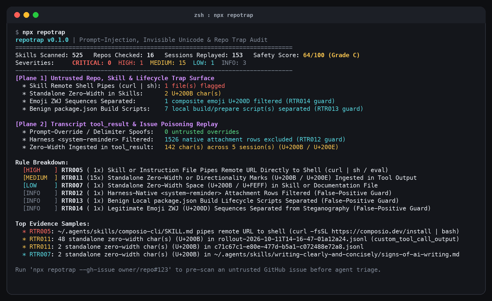

<p align="center">
  
</p>

<h1 align="center">repotrap</h1>

<p align="center">
  Zero-dependency prompt-injection, invisible Unicode steganography, spoofed <code>&lt;system-reminder&gt;</code> delimiter, and repo-open execution trap scanner for Claude Code, Codex CLI, skills, and GitHub issues.
</p>

<p align="center">
  
</p>

## Why I built this

In today's `r/ClaudeAI` thread (`1xozfcv`, *"Why are more than 98% of 16,060 open GitHub issues on anthropics/claude-code unassigned?"*) and `r/ExperiencedDevs` thread (`1xnl43h`, *"The Agentic Code Review Dilemma"*), maintainers pointed out the core blocker to letting coding agents triage issues, review PRs, or inspect cloned repos: **untrusted input poisoning and repo-open execution traps**.

When you point Claude Code or Codex CLI at an external GitHub issue (`gh issue view`), a cloned PR branch, or a third-party `SKILL.md` file, four classes of traps can hijack the agent:
1. **Workspace config auto-execution**: `.claude/settings.json` (`hooks`, `apiKeyHelper`, `statusLine`), `.mcp.json`, or `.vscode/tasks.json` (`"runOn": "folderOpen"`) inside a cloned repo that execute arbitrary commands when the agent starts.
2. **Invisible Unicode steganography**: Unicode Tag characters (`U+E0000` to `U+E007F`), bidirectional overrides (`U+202A` to `U+202E`), and standalone zero-width spaces (`U+200B`) hiding instructions that humans cannot see in the browser.
3. **Spoofed `<system-reminder>` and `</tool_result>` delimiters**: Untrusted issue bodies or web pages attempting to close the tool output block and inject fake system reminders.
4. **Hidden HTML comment instructions & remote shell pipes**: `<!-- ignore previous instructions -->` inside Markdown issues or `curl ... | bash` inside installed `SKILL.md` files.

## Quickstart

Audit your installed skills, workspace repos, and historical `.jsonl` transcripts:

```bash
npx repotrap
```

Pre-scan an untrusted GitHub Issue or PR before handing it to a coding agent:

```bash
npx repotrap --gh-issue owner/repo#123
```

Generate a deterministic Claude Code `PostToolUse` sanitizer hook:

```bash
npx repotrap --emit-hook
```

## Real audit on 525 skill files, 16 repos, and 153 transcripts

Running `npx repotrap` across `525` local skill markdown files (`~/.gemini/config/skills` and `~/.agents/skills`), `16` workspace repos, and `153` local Claude Code and Codex CLI transcripts surfaced three false-positive traps that naive scanners hit, plus real findings:

1. **Claude Code native `type: "attachment"` `<system-reminder>` inflation (`1,526` native rows vs `0` spoofed `tool_result` delimiters)**: Scanning raw `.jsonl` lines for `<system-reminder>` matched `1,526` rows across `125` sessions because Claude Code serializes its own internal reminders as `type: "attachment"` and `type: "api-request-*"` records. `repotrap` parses the JSONL structure (`RTR012`) and only flags `<system-reminder>` or `</tool_result>` when it appears inside an untrusted `tool_result` or `function_call_output` payload (`RTR008`).
2. **Codex `custom_tool_call_output` object serialization (`142` zero-width chars across `15` tool outputs in `5` sessions)**: Unlike `function_call_output` (where `payload.output` is a string), Codex CLI's `custom_tool_call_output` stores `payload.output` as a nested JSON object. Naive `String(payload.output)` coercion turns the entire payload into `"[object Object]"` and misses `138` of the `142` ingested `U+200B`/`U+200E` characters (`RTR011`).
3. **Composite Emoji `U+200D` ZWJ vs standalone `U+200B` (`RTR014`) and local build scripts (`RTR013`)**: `repotrap` separates composite emoji zero-width joiners (`1` in `notebook-guidance/SKILL.md`) and benign local `package.json` build scripts (`7` across `16` repos) from `1` live `curl -fsSL https://composio.dev/install | bash` remote shell pipe in `composio-cli/SKILL.md` (`RTR005`) and `2` standalone `U+200B` characters in `signs-of-ai-writing.md` (`RTR007`).

## Rules (`RTR001` to `RTR014`)

| Rule | Plane | Severity | What it detects |
| :--- | :--- | :--- | :--- |
| `RTR001` | Repo | `CRITICAL` | Workspace `.claude/settings.json` defining `hooks`, `apiKeyHelper`, `otelHeadersHelper`, or `statusLine` |
| `RTR002` | Repo | `CRITICAL` | Workspace `.mcp.json` or `.vscode/tasks.json` (`"runOn": "folderOpen"`) spawning commands on open |
| `RTR003` | Repo | `CRITICAL` | Unicode Tag characters (`U+E0000`–`U+E007F`) or Bidirectional Overrides (`U+202A`–`U+202E`) |
| `RTR004` | Repo | `HIGH` | HTML comments (`<!-- ... -->`) in Markdown/skills containing imperative prompt-injection verbs |
| `RTR005` | Repo | `HIGH` | Skill or instruction file piping a remote URL directly into `sh` / `bash` (`curl ... \| bash`) |
| `RTR006` | Repo | `MEDIUM` | `package.json` `preinstall`/`postinstall` hook running network or shell payloads |
| `RTR007` | Repo | `LOW` | Standalone zero-width space (`U+200B` / `U+FEFF`) inside skill or documentation files |
| `RTR008` | Transcript | `CRITICAL` | Spoofed `<system-reminder>`, `</tool_result>`, or `<function_calls>` inside untrusted tool output |
| `RTR009` | Transcript | `CRITICAL` | Explicit prompt-override phrase (`ignore previous instructions`) inside untrusted tool output |
| `RTR010` | Transcript | `HIGH` | Hidden HTML comment inside `tool_result` containing imperative agent/shell instructions |
| `RTR011` | Transcript | `MEDIUM` | Standalone zero-width or directionality characters (`U+200B`, `U+200E`) ingested via tool output |
| `RTR012` | Transcript | `INFO` | Claude Code native `type: "attachment"` `<system-reminder>` rows filtered out (False-Positive Guard) |
| `RTR013` | Repo | `INFO` | Benign local `package.json` build/prepare scripts separated (False-Positive Guard) |
| `RTR014` | Repo | `INFO` | Composite Emoji `U+200D` ZWJ sequences separated from Unicode steganography (False-Positive Guard) |

## Limitations

- **Syntactic & structural detection**: `repotrap` deterministically catches invisible Unicode (`U+E0000` tags, Bidi overrides, standalone `U+200B`), spoofed XML/harness delimiters (`<system-reminder>`, `</tool_result>`), HTML comment instructions, `curl | sh` skill pipes, and `.claude`/`.mcp.json`/`.vscode` repo-open hooks. It cannot prove whether natural-language prose without structural markers or imperative override phrases will sway a model's reasoning.
- **`--gh-issue` requires GitHub CLI (`gh`)**: Pre-scanning live GitHub issues (`npx repotrap --gh-issue owner/repo#123`) invokes your authenticated `gh issue view` CLI.

## License

MIT
